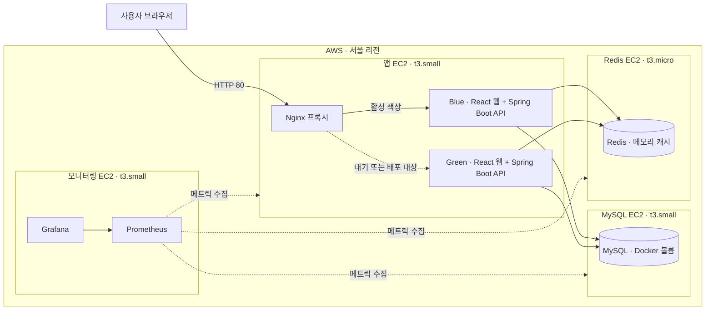
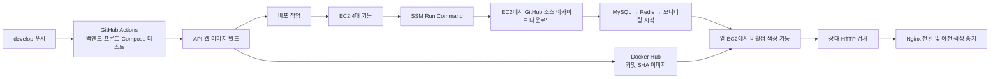

# AWS 배포 아키텍처

아래 그림은 EC2가 실행 중일 때의 구성이다. 리전은 서울(`ap-northeast-2`)이며, 외부 서비스 주소는 `terraform output -raw app_url`로 확인한다.

그림은 Blue가 활성화된 경우를 예시로 든 것이다. 다음 배포에서는 Green이 활성화될 수 있다. 두 색상은 배포 중 잠시 함께 실행되며, Nginx는 검사를 통과한 한쪽으로만 사용자 요청을 보낸다. MySQL·Redis·모니터링은 외부에 공개하지 않으며, Grafana는 SSM 포트 포워딩으로 접속한다.

## 배포 흐름

배포가 실패하면 앱 EC2는 기존 활성 색상을 유지하거나 되돌린다. 네 EC2는 부팅 약 4시간 뒤 자동 중지된다. MySQL 데이터는 EC2 중지·재시작 후에도 루트 EBS의 Docker 볼륨에 남고, Redis 캐시는 재시작 시 사라진다.

자세한 운영 절차는 [AWS 배포 운영](aws-deployment.md)을 참고한다.
